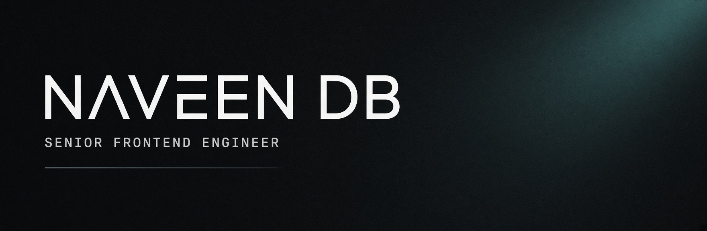
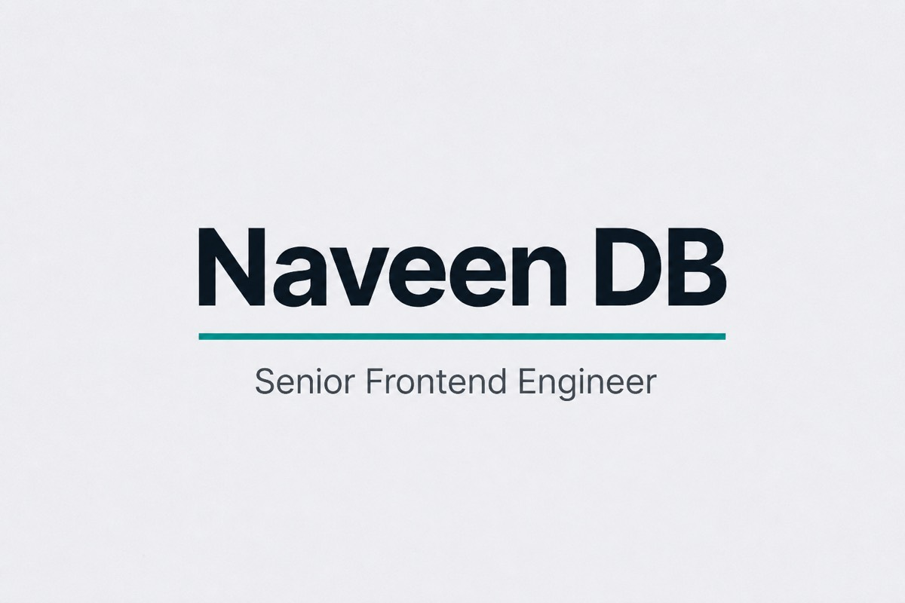

<!--
  Profile README — github.com/naveendb-fe
  Visual system aligned with naveendb.in
-->

  <picture>
    <source media="(prefers-color-scheme: dark)" srcset="./assets/banner-dark.jpg" />
    <source media="(prefers-color-scheme: light)" srcset="./assets/banner-light.jpg" />
    
  </picture>

  <a href="https://naveendb.in"><strong>naveendb.in</strong></a>
  &nbsp;·&nbsp;
  <a href="https://naveendb.in/work/granicus-design-system">Design system</a>
  &nbsp;·&nbsp;
  <a href="https://www.linkedin.com/in/naveendb92">LinkedIn</a>
  &nbsp;·&nbsp;
  <a href="https://medium.com/@naveendb92">Writing</a>
  &nbsp;·&nbsp;
  <a href="mailto:naveendb92@gmail.com">Email</a>

 

I build **design systems** and product interfaces that stay coherent when products multiply — shared foundations, accessible components, and clear interaction.

Currently **Senior Frontend Engineer at Granicus**, owning and evolving the Granicus Design System with design partners. Before that: enterprise analytics and IoT product UI at Accenture AI, Kogentix, and Flutura.

  

### Now

Most of my depth is in **design-system foundations** — tokens, React component APIs, Storybook, Figma libraries, and contribution paths that let product teams adopt one system instead of forking UI per surface.

Day to day I also work with **AI** — agents, shared skills, MCP, and the model that fits the job (Claude, GPT, Gemini, Grok) — so that work moves faster without lowering the bar.

Accessibility and predictable interaction are the bar, not a polish pass at the end.

### Selected work

<table>
<tr>
<td width="54%" valign="top">

</td>
<td width="46%" valign="top">

**[Granicus Design System](https://naveendb.in/work/granicus-design-system)**  
`Granicus` · `2022 — Present`  
Tokens, React components, patterns, and docs for multi-product UI. Drafts move through agents and skills, then get checked against the system.

**[Delivery Inaccuracy](https://naveendb.in/work/delivery-inaccuracy)**  
`Accenture AI` · `Next.js`  
Reporting for restaurant performance and order inaccuracies.

**[naveendb.in](https://naveendb.in)**  
`React` · `TypeScript` · `Vite`  
Portfolio and case studies — the public face of the work.

</td>
</tr>
</table>

### Writing

- [Clean, predictable React tests with Jest & RTL](https://medium.com/@naveendb92/writing-clean-predictable-test-cases-in-react-using-jest-and-rtl-0fcabea4e47d) — naming, helpers, patterns that scale
- [Free SSL on a GoDaddy-hosted site](https://medium.com/@naveendb92/how-to-install-a-free-ssl-certificate-on-your-godaddy-hosted-website-1b47e7454c71) — practical web-ops walkthrough

### Stack

`AI` · `React` · `TypeScript` · `Design systems` · `Storybook` · `Vue` · `Angular` · `Next.js` · `Jest` · `Testing Library` · `Figma`

<strong>Experience</strong>

 

**Granicus Inc.** — Senior Frontend Engineer · Sep 2022 — Present  
Own and evolve the Granicus Design System with design partners — foundations, React components, patterns, Storybook, and contribution paths across product surfaces. AI sits in that practice: agents, shared skills, MCP, and the model that fits the job.

**Accenture AI** — Front-end Engineer · Dec 2018 — Sep 2022  
Analytics and insights product UI after Kogentix was acquired — Next.js reporting, Vue insights shells, React expense tooling.

**Kogentix Inc.** — UI Engineer · Jun 2017 — Nov 2018  
Angular interfaces for Asset Insights (IoT) and the Automated Machine Learning Platform (AMP).

**Flutura** — Programmer / Frontend Developer · Aug 2015 — May 2017  
IoT and analytics UIs for supply-chain and solar operations products.

 

  

  Bangalore · <a href="https://naveendb.in">naveendb.in</a> · <a href="mailto:naveendb92@gmail.com">naveendb92@gmail.com</a>

